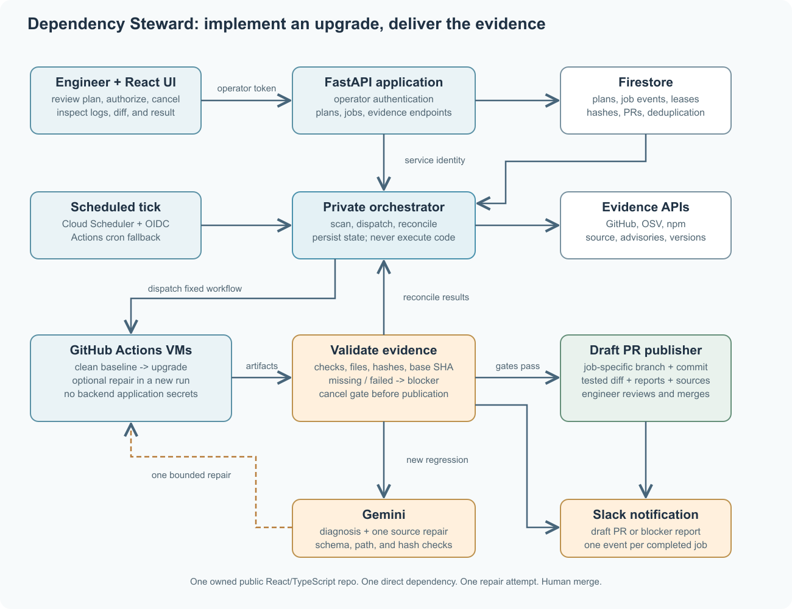

# Dependency Steward Level 1 Solution Design

## Executive summary

Dependency Steward is a dependency upgrade engineer for a small React/TypeScript SaaS team. It turns one selected dependency update into a reviewable code change: inspect the repository, establish a test baseline, upgrade the package, diagnose regressions, attempt one bounded compatibility repair, and open a draft pull request (PR) with the exact diff and validation evidence. Daily scanning identifies work; an engineer authorizes each upgrade plan in the UI. The agent then completes the bounded workflow without requiring the dashboard to remain open. Engineers review and merge the result.

**Role and industry:** Dependency maintenance engineer for a JavaScript/TypeScript SaaS product. The prototype supports one operator-owned public React/TypeScript repository using npm and one package-lock.json v2/v3 file.

**Core outcome:** A draft PR with a dependency change, any permitted source repair, baseline-versus-upgrade test results, and source-linked rationale; or a precise blocker report when the workflow cannot complete. Value is measured by work delivered and evidence produced, rather than alert volume.

## Product value and existing tools

Dependabot already detects vulnerable dependencies and opens update PRs; GitHub also prioritizes alerts and supports grouping updates. Dependency Steward therefore does not claim that ranking alerts or bumping versions is novel. Its product focus is the maintainer workflow after choosing an update: locate affected usage, reproduce the current test state, try the upgrade, explain a regression, attempt a constrained source adaptation, and package the result for review. The product hypothesis is that completing these steps saves more maintainer effort than another triage dashboard. The demo measures completion rate, repair outcome, test results, elapsed time, and remaining human steps; it does not invent time-savings estimates. Sources: [GitHub alert review](https://docs.github.com/en/code-security/how-tos/manage-security-alerts/manage-dependabot-alerts/view-dependabot-alerts); [Dependabot PR management](https://docs.github.com/en/code-security/tutorials/secure-your-dependencies/optimizing-pr-creation-version-updates).

Maintainer responsibilities and prototype scope

**Research basis and priorities:** GitHub’s maintainer guidance describes assessing advisory details, choosing remediation or justified dismissal, and reviewing update PRs. Its grouping guidance addresses review overload; npm documents reproducible installation and explicit script execution. These responsibilities lead to the priorities below: first produce an evidence-backed upgrade and validate it, then automate the repeatable compatibility investigation, with scanning and notifications supplying the work queue. License review, broad refactoring, and routine update batching remain outside the prototype. The impact ordering is a product decision, not a measured industry statistic. Sources: [GitHub alert review](https://docs.github.com/en/code-security/how-tos/manage-security-alerts/manage-dependabot-alerts/view-dependabot-alerts); [Dependabot PR management](https://docs.github.com/en/code-security/tutorials/secure-your-dependencies/optimizing-pr-creation-version-updates); [npm ci](https://docs.npmjs.com/cli/v11/commands/npm-ci).

| Maintainer responsibility | Priority and product impact | Automated workflow |
| --- | --- | --- |
| Assess advisories and select an upgrade | High: connects installed risk to a specific change | Scan exact versions, trace dependency paths, verify target metadata, and present a ranked plan |
| Establish test state and execute an update | Highest: produces a reviewable engineering result | Run a clean baseline, update one dependency and lockfile, and run required checks |
| Investigate compatibility regressions | High: explains why an upgrade fails | Connect release notes, affected source, and diagnostics; attempt one constrained repair and rerun |
| Review evidence and deliver the change | Highest: turns execution into an actionable artifact | Show diffs and before/after results; open a draft PR or record the blocker; notify the engineer |
| Batch updates, assess licenses, replace abandoned packages | Recurring work deferred to keep the workflow complete | Outside prototype scope |

## User workflow and meaningful actions

1. **Connect and inspect.** The operator configures one owned public repository, its lockfile, a pinned Node/npm toolchain, reviewed source paths, and required test/typecheck/build commands. The dashboard shows advisory evidence, dependency paths, published target versions, existing PRs, and the last scan. Scheduled scans refresh this queue and notify on meaningful changes.

2. **Authorize one plan.** The engineer selects a direct dependency and exact published target version. The plan displays the base commit SHA, affected source references, release-note evidence, allowed file paths, test commands, time limits, and permission to create a draft PR. A server-side plan hash records this authorization. Scheduled scanning alone never authorizes repository writes.

3. **Establish a baseline and attempt the upgrade.** The agent dispatches a trusted GitHub Actions workflow. Separate clean jobs run the baseline and upgraded candidate with the same pinned toolchain and command profile. A failed baseline produces a baseline-blocked report, rather than blaming the upgrade. On a clean baseline, the candidate changes the selected dependency, regenerates the lockfile with npm, and reruns all required checks. The UI shows stage progress, command exit codes, test counts, durations, logs, and the diff.

4. **Diagnose and attempt one repair.** If the upgrade introduces a failure, Gemini receives bounded release notes, matching source snippets, and failing diagnostics. It proposes an explanation and a structured source edit. The backend validates the edit against the authorized paths and file hashes, then dispatches one repair run against the exact first-run candidate. The repair cannot alter tests, workflows, build configuration, or unrelated dependencies. There is no open-ended retry loop.

5. **Publish or report the blocker.** When the baseline and all candidate checks pass, the backend verifies the final artifact and unchanged base SHA, creates one job-specific branch, commits the validated changes, and opens a draft PR. Its body includes old/new versions, source references, advisory comparison, repair rationale, command results, run links, and limitations. An unresolved failure, missing evidence, cancellation, or moved base produces a blocker report and no PR. A changed base requires a new plan.

6. **Review and control.** The engineer reviews the draft PR and decides whether to merge. The responsive dashboard provides the candidate queue, plan review, a run timeline, baseline/candidate comparison, file diffs, and a final PR or blocker link. It supports Scan now, start, cancel, retry with a new plan, acknowledgement, and 1/7/30-day snooze. Slack sends one completion/blocker notification per run and deduplicated scan alerts.

Architecture



Figure 1  Dependency Steward: discover, authorize, execute, repair, and publish evidence. [Editable SVG source](https://drive.google.com/file/d/1poJ1AKMm_kkfiLsDtUoBujWaQE9vv-kJ/view).

**Application and orchestration:** A React + TypeScript frontend is served by a public FastAPI Cloud Run app. The backend exposes repository configuration, scan results, plans, run status, evidence, and operator actions. A single operator token protects the prototype UI/API, including evidence reads and all writes; it is supplied at sign-in and never embedded in public client assets. Repository code and npm scripts never execute in the web service.

**Durable worker:** A private Cloud Run worker performs scans, invokes Gemini, dispatches GitHub Actions, reconciles workflow results, and publishes draft PRs. Firestore stores repository configuration, immutable plan versions, approvals, job state/events, artifact hashes, snoozes, notification keys, and PR URLs. One Cloud Scheduler job invokes the worker every five minutes using OIDC; the worker reconciles active jobs and performs the daily scan when its Africa/Addis_Ababa due time arrives. Operator actions invoke the same worker through the app’s service identity. There is no process-local background queue or persistent local SQLite. Source: [Cloud Scheduler with Cloud Run](https://docs.cloud.google.com/run/docs/triggering/using-scheduler).

**Execution environment:** A reviewed workflow on the repository’s default branch runs on standard GitHub-hosted ubuntu-24.04 VMs. The upgrade job runs only after the baseline succeeds, in a separate clean VM; a repair uses a new run and downloads the exact candidate artifact by run ID and hash. The operator owns the demo repository and reviews its scripts. Workflow actions are pinned by commit SHA; checkout disables persisted credentials. Execution jobs use a read-only GITHUB_TOKEN, no OIDC permission, and no backend GitHub, Gemini, Slack, or cloud secrets. This prototype is not a service for arbitrary hostile repositories. Sources: [GitHub-hosted runners](https://docs.github.com/en/actions/reference/runners/github-hosted-runners); [Actions security guidance](https://docs.github.com/en/actions/reference/security/secure-use).

**Repository access and publication:** A fine-grained GitHub token is stored only in the backend and restricted to the configured repository, with Contents, Pull requests, and Actions read/write permissions for branch creation, draft PRs, dispatch, result reads, and cancellation. No administration or workflow-file editing permission is requested. Before publishing, the backend checks that the default-branch head still equals the authorized base, that every changed file is permitted, and that final file hashes match the tested artifact. It uses a stable steward/<job-id> branch and reuses an existing PR on retry. It never pushes the default branch, force-pushes, merges, or deploys application code. Sources: [GitHub workflows API](https://docs.github.com/en/rest/actions/workflows); [GitHub pull requests API](https://docs.github.com/en/rest/pulls/pulls).

**Evidence transport:** GitHub’s workflow and artifact APIs link each stage to its job ID, authorized plan hash, base SHA, workflow identity, and run ID. The worker retrieves artifacts with a 10 MiB uncompressed cap, safe archive extraction, and logs capped at 1 MiB per job, validates their manifest, and persists normalized results. Artifacts contain command results, capped logs, package manifests, lockfiles, final source changes, and hashes; retention is seven days, with metadata retained in the database. A completed Actions run without all required result records is incomplete, not successful. Source: [GitHub Actions artifacts API](https://docs.github.com/en/rest/actions/artifacts).

## Integrations, free access, and usage limits

GitHub REST and Open Source Vulnerabilities (OSV) provide the two required free data integrations; the npm registry supplies published versions and release context. Gemini supplies bounded reasoning and source edits. GitHub Actions executes reviewed jobs, and Slack delivers notifications. Provider limits and application budgets are kept distinct.

**GitHub:** Public-repository API access requires no paid plan. Primary REST limits are 60 requests/hour unauthenticated and generally 5,000/hour with a personal token. The prototype uses authenticated calls, commit-SHA caches, conditional metadata reads, and quota/reset headers. Scanning is capped at 200 requests per scan. Active-job reconciliation polls at most once per five-minute tick, with a separate 200-request budget per upgrade. Rate-limited work is deferred without duplicate dispatch or publication. Sources: [GitHub rate limits](https://docs.github.com/en/rest/using-the-rest-api/rate-limits-for-the-rest-api); [GitHub API practices](https://docs.github.com/en/rest/using-the-rest-api/best-practices-for-using-the-rest-api).

**OSV:** No paid plan or API key is required. The FAQ currently states no API rate limit; the client still batches 100 deduplicated package/version queries with at most two requests in flight, follows pagination, and backs off on failures. Full advisory details are fetched where needed. Incomplete results cannot establish that an advisory was removed. Sources: [OSV batch API](https://google.github.io/osv.dev/post-v1-querybatch/); [OSV service limits](https://google.github.io/osv.dev/faq/).

**npm:** Public metadata requires no paid npm plan. Candidate versions must exist in registry metadata; the model cannot invent them. Cache release metadata for 24 hours and query only candidate packages. No guaranteed provider request quota is assumed. Retry throttled requests with bounded backoff; show unavailable context on failure. Source: [npm public-registry terms](https://docs.npmjs.com/policies/open-source-terms/).

**Gemini:** Use gemini-3.5-flash-lite structured output on the available free tier, checking actual project RPM/TPM/RPD limits in AI Studio. Each upgrade has at most three model requests including retries: one evidence-backed plan, one repair proposal if required, and one final explanation. Inputs and outputs are capped; cached results are keyed by evidence hash. A model failure leaves deterministic scanning and the version-only upgrade available; a required repair becomes blocked. Sources: [Gemini model](https://ai.google.dev/gemini-api/docs/models/gemini-3.5-flash-lite); [Gemini pricing](https://ai.google.dev/gemini-api/docs/pricing); [Gemini project limits](https://ai.google.dev/gemini-api/docs/rate-limits).

**Actions and Slack:** Standard GitHub-hosted runners are free for public repositories, subject to service availability and policy. Use no larger or self-hosted runner. Permit one active upgrade per repository, a ten-minute timeout per execution job, and at most two workflow runs per upgrade: baseline/upgrade, then optional repair. Slack uses an authorized incoming webhook and event-key deduplication; an uncertain delivery is recorded rather than retried blindly. Sources: [Standard runner availability](https://docs.github.com/en/actions/reference/runners/github-hosted-runners); [Slack incoming webhooks](https://docs.slack.dev/messaging/sending-messages-using-incoming-webhooks/).

## Candidate selection and upgrade verification

The daily scan fetches the default-branch lockfile and up to ten open Dependabot PRs, queries exact installed versions against OSV, and lists actionable candidates. Existing PRs are linked to avoid duplicate work. Only direct-dependency upgrades are executable in the prototype; transitive findings show their parent path and remain investigation items. The engineer selects the exact target version and authorizes the plan.

score = clamp(severity + exposure + published_target + novelty + evidence, 0, 100)

- **severity (0–40):** Highest relevant CVSS score multiplied by four and rounded. Parse vectors with a CVSS library; otherwise map critical/high/moderate/low to 40/30/20/10. Unknown severity scores 15 and is labeled unknown.

- **exposure (0–20):** Production dependency path 20; development-only 5; unknown 10. This is a triage signal, not proof of exploitability.

- **published_target (0–20):** Score 20 when a candidate has a registry-verified target for a supported direct dependency; otherwise 0 and investigation-only. A published version is not labeled a verified fix before the resulting lockfile is checked.

- **novelty (0–10):** New advisory in the latest scan 10, otherwise 0.

- **evidence (0–10):** Complete current lockfile and advisory data 10; incomplete data 0 with an explicit uncertainty label. Deterministic selection and job outcomes never use the model’s confidence as evidence.

Sort by score, then severity, then a stable package/advisory identifier. Acknowledgement suppresses repeated alerts for unchanged evidence. Snoozed items leave the top three for 1, 7, or 30 days; a new advisory, higher severity, or changed target clears snooze. Baseline scans send one explicit baseline notification; subsequent scans notify only on meaningful changes. Candidate ranking is separate from upgrade authorization.

**Reproducible validation:** The demo profile pins Node/npm versions and the required commands npm run test:ci, npm run typecheck, and npm run build. Missing scripts are a setup error, never silently skipped. Baseline and candidate use the same environment with clean installs and npm ci --ignore-scripts; reviewed commands run explicitly with pre/post hooks disabled. A dependency requiring an unapproved lifecycle script blocks the job. The upgrade changes only the selected direct dependency entry, regenerates package-lock.json with npm, and reports all transitive changes. The repair preserves that exact candidate lockfile. Sources: [npm ci](https://docs.npmjs.com/cli/v11/commands/npm-ci); [npm script controls](https://docs.npmjs.com/cli/v11/using-npm/config/#ignore-scripts).

**Evidence rules:** A verified outcome requires a clean baseline, successful installation, all configured checks completed with passing exit codes, and a matching tested artifact. Record failed test names/counts, command durations, and logs for both versions. A reduction in test count, missing test report, or modified tests blocks publication. Re-query the final lockfile against OSV and show removed, remaining, and new advisories separately; a newly introduced advisory blocks publication, and an unavailable OSV comparison remains unverified and blocks publication. Passing checks demonstrate only the configured coverage, not universal upgrade safety.

## AI contract and bounded repair

Gemini receives a bounded evidence bundle: exact versions from npm, advisory IDs, release-note excerpts, source snippets that reference the selected dependency, and baseline/candidate diagnostics. Repository text, release notes, and logs are untrusted input. The model may explain a plan, propose one source adaptation, and draft a final rationale. It cannot choose credentials, shell commands, workflow configuration, target versions, or publication policy.

```json
{
  "diagnosis": "string",
  "evidence_ids": ["id"],
  "edits": [{"path": "src/file.ts", "before_sha256": "hash",
             "new_content": "string"}],
  "uncertainty": "string"
}
```

**Repair prompt excerpt:** “Explain the new failure using only the supplied release notes, source, and diagnostics. Propose the smallest compatible source change for the exact target version. Edit only allowlisted source files. Do not change tests, dependencies, scripts, workflows, or configuration. Return the structured object; if evidence is insufficient, return no edits and explain the blocker.”

**Validation and fallback:** Enforce the JSON schema; evidence IDs must exist and quoted release-note text must match its source. Reject absolute paths, traversal, symlinks, hash mismatches, non-allowlisted files, and edits to tests, manifests, lockfiles, workflows, or build configuration. Limit a repair to five source files, 200 changed lines, and 24 KiB of new content. The backend applies data edits with a deterministic helper, never model-generated shell. The new artifact must pass the same checks before publication. Invalid output or a failed repair ends in a blocker report; it is not described as a successful fix. Source: [Gemini structured output](https://ai.google.dev/gemini-api/docs/structured-output).

**Run state and recovery:** Persist queued, running_baseline_upgrade, diagnosing, running_repair, publishing, succeeded, blocked, cancelled, and stale states, with stage-level events and reason codes. Use a per-repository lease and compare-and-set transitions. Persist a dispatch intent and job correlation ID before calling GitHub; on an uncertain response, search matching runs before retrying. Use job ID and attempt number for workflow concurrency and reject stale/duplicate artifacts. A cancellation accepted before publishing prevents PR creation even if remote execution stops later. Once publishing begins, cancellation cannot retract an external API request already in flight; the UI shows that boundary and reconciliation records the actual outcome. Reconciliation resumes after backend restarts; retry requires a fresh plan when the base or evidence has changed.

## Deployment and acceptance criteria

**Hosting:** The public app, private worker, and Firestore form the GCP deployment. Cloud Run executes orchestration only; GitHub-hosted VMs execute repository code. Server-side GitHub, Gemini, Slack, and operator credentials are stored as secrets. Google requires a billing account for its Free Tier, so no-card GCP availability is not assumed. If GCP cannot be used under the account constraints, deploy the combined React/FastAPI app on Render Free with Render Free Postgres and a GitHub Actions cron that calls the token-protected reconciliation endpoint. The fallback keeps the same execution workflow and state transitions. Sources: [Google Cloud Free Tier](https://docs.cloud.google.com/free/docs/free-cloud-features); [Render Free](https://render.com/docs/free).

**Operational limits:** The daily scan uses Africa/Addis_Ababa time. The five-minute reconciler introduces visible scheduling latency; status polling in an open dashboard can refresh earlier. GitHub Actions cron fallback may be delayed. Render’s free web service can sleep, and its free Postgres expires after 30 days, so that path serves the demonstration. Cloud/runner/model quotas and account access are checked during setup; none of the local filesystems hold authoritative job history.

Acceptance is demonstrated with an operator-owned public React/TypeScript fixture that has real npm dependencies, stable tests, and a reviewed execution workflow. The following evidence is required:

1. Live GitHub, OSV, and npm reads produce source-linked candidates with exact versions, dependency paths, uncertainty labels, and deterministic scores.

2. A plan records the base SHA, exact target version, permitted files, commands, and publication authorization; unsupported or unpublished targets are rejected.

3. A compatible upgrade produces a draft PR with the tested manifest/lockfile, baseline and candidate reports, run links, and exact diff.

4. A real breaking dependency upgrade demonstrates diagnosis, one bounded source repair, rerun results, and a draft PR if checks pass. If repair fails, the UI shows the blocker and publishes no PR.

5. A failing baseline, stale base SHA, attempted test/workflow edit, missing artifact, and cancellation each prevent publication with a clear reason.

6. Replaying a worker tick or dispatch result creates no duplicate job, branch, PR, or completion notification. A persisted in-flight job recovers after an API restart.

7. The UI demonstrates plan authorization, stage progress, logs, baseline/candidate comparison, diff review, cancellation, and PR/blocker navigation. A scheduled scan and one unattended completion trigger Slack; snooze suppresses unchanged scan alerts.

8. Focused tests cover lockfile/advisory handling, plan validation, patch limits, artifact validation, state transitions, idempotency, and publication gates. Deliver the deployed app, source code, setup instructions, and a video covering the problem, UI workflow, and frontend/backend implementation.

**Scope boundaries:** One public owned repository, one npm lockfile, one direct dependency per job, and one repair attempt. No private/customer repositories, monorepos, automatic merges, deployments, arbitrary shell generation, license automation, or broad code refactoring. Tests and automation policies remain engineer-owned. Mocked records may exercise failure tests but are labeled and do not replace the live upgrade demonstration.

**Path to production:** Replace the prototype token with a repository-scoped GitHub App; add multi-user authentication, stronger isolation for untrusted customer code, policy-controlled network access, longer-lived evidence storage, and broader ecosystem support. These extensions are outside the core demonstration.
